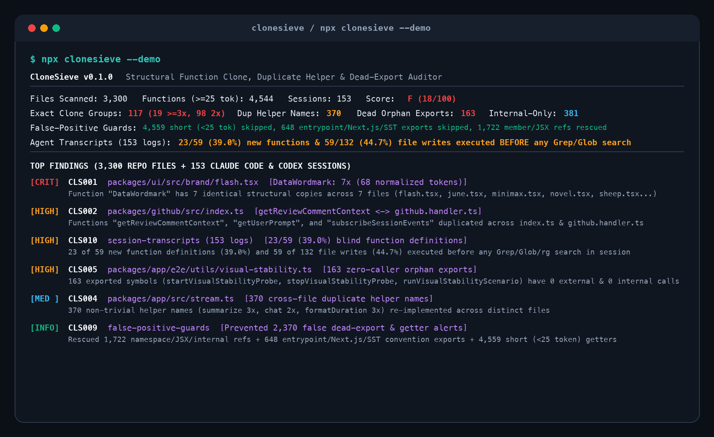

<div align="center">
  
  <h1>clonesieve</h1>
  <p><strong>Zero-dependency codebase structural function clone, duplicate helper & dead-export auditor + Claude Code & Codex blind-write transcript scanner</strong></p>
  <p>
    <a href="https://www.npmjs.com/package/clonesieve"></a>
    <a href="https://github.com/princejain756/clonesieve/blob/main/LICENSE"></a>
    = 18" />
    
  </p>
</div>

<p align="center">
  
</p>

## Why CloneSieve Exists

When AI coding agents work inside a growing repository, they rarely search existing modules before adding a helper. Instead of importing an existing utility from `packages/github/src/index.ts`, the agent writes a fresh `getReviewCommentContext()` or `subscribeSessionEvents()` right inside the file it is editing. Over months, the repository accumulates 3 to 7 copies of the same helper logic and hundreds of orphaned exports that no file calls anymore.

We audited a 3,300-file TypeScript/React/Python monorepo (`4,544` non-trivial functions >= 25 normalized tokens) alongside `153` local Claude Code (`~/.claude/projects/**/*.jsonl`) and Codex CLI (`~/.codex/sessions/**/*.jsonl`) transcripts:

- **117 Structural Function Clone Groups (`CLS001` / `CLS002`)**: `19` multi-file exact clone clusters (`>= 3` copies) and `98` pairwise structural clones (`2` copies) across distinct files. For example, `DataWordmark` is copy-pasted `7` times across `flash.tsx`, `june.tsx`, `minimax.tsx`, `novel.tsx`, `sheep.tsx`, `video.tsx`, and `stats-shell.tsx`; `getReviewCommentContext`, `getUserPrompt`, and `subscribeSessionEvents` are duplicated across `index.ts` and `github.handler.ts`.
- **370 Cross-File Duplicate Helper Names (`CLS004`)**: `370` non-trivial function names (`>= 25` tokens) are re-implemented in 2 or more separate files (`summarize` in 3 files, `chat` in 2 files).
- **39.0% Blind Function Additions in Agent Transcripts (`CLS010` / `CLS011`)**: Across `153` Claude Code and Codex sessions, `23` of `59` new function definitions (`39.0%`) and `59` of `132` file write/patch calls (`44.7%`) were executed before the agent ran a single `Grep`, `Glob`, or `rg` search in that session.
- **163 Truly Dead Zero-Caller Orphan Exports (`CLS005`) vs 381 Internal-Only Over-Exports (`CLS006`)**: After filtering out `1,722` namespace/JSX/internal references and `648` framework entrypoint conventions (`index.ts`, `page.tsx`, `route.ts`, `sst.config.ts`), `163` exported symbols had zero external references and zero internal calls (`startVisualStabilityProbe`, `stopVisualStabilityProbe`, `runVisualStabilityScenario`).

## Three False-Positive Traps Caught During Benchmarking

| Naive Heuristic Trap | Raw Unfiltered Alerts | Actual Verified Count | How CloneSieve Filters False Positives |
| :--- | :---: | :---: | :--- |
| **Import-brace-only regex for dead exports** (`import { foo }`) | `2,266` | `163` truly dead + `381` internal-only | Tracks whole-repo identifier occurrences across files (`ns.foo`, `<Component />`, callbacks) and separates same-file callers (`CLS006`) from zero-caller orphans (`CLS005`), rescuing `1,722` live symbols. |
| **Flagging framework & package entrypoints as dead exports** | `648` entrypoints + `270` barrels | `0` false alerts | `CLS009` excludes `index.ts`, `main.ts`, `cli.ts`, Next.js route/page conventions (`page.tsx`, `layout.tsx`, `route.ts`, `GET`, `POST`, `metadata`), SST/Vite/Vitest configs, and `export * from` barrels. |
| **Matching short getters & 2-line boilerplate as clones** | `4,559` short functions | `117` non-trivial clone groups | `CLS008` requires `>= 25` Type-2 normalized tokens before computing structural hashes or 4-gram Jaccard shingles. |

## Quick Start

```bash
# Run built-in 3,300-file + 153-session benchmark demo
npx clonesieve --demo

# Audit your repository for structural clones, duplicate helpers, and dead exports
npx clonesieve .

# Audit repo + scan local Claude Code & Codex transcripts for blind writes
npx clonesieve . --with-transcripts

# Generate a Canonical Helper Registry markdown snippet for CLAUDE.md / AGENTS.md
npx clonesieve . --emit-index

# Enforce in CI (exit 1 on HIGH or CRITICAL findings)
npx clonesieve ./src --fail-on high --json
```

## 14 Audit Rules (`CLS001` to `CLS014`)

| Rule ID | Plane | Severity | Description |
| :--- | :--- | :--- | :--- |
| `CLS001` | Codebase | `CRITICAL` | Multi-file exact structural clone (`>= 3` copies of identical Type-2 normalized body) |
| `CLS002` | Codebase | `HIGH` | Pairwise structural function clone (`2` copies across distinct files) |
| `CLS003` | Codebase | `HIGH` | Near-duplicate shingle clone (`4`-gram normalized token Jaccard similarity `>= 0.80`) |
| `CLS004` | Codebase | `MEDIUM` | Cross-file duplicate helper name sprawl (same function name re-implemented across files) |
| `CLS005` | Codebase | `HIGH` | Truly dead zero-caller orphan export (`0` cross-file references and `0` internal calls) |
| `CLS006` | Codebase | `LOW` | Internal-only over-exported symbol (exported but only called inside its defining file) |
| `CLS007` | Codebase | `MEDIUM` | Trivial pass-through wrapper function (single-call delegation without transformation) |
| `CLS008` | Guard | `INFO` | Short boilerplate & getter exclusion guard (`< 25` normalized tokens excluded) |
| `CLS009` | Guard | `INFO` | Entrypoint, Next.js/SST convention & barrel re-export false-positive guard |
| `CLS010` | Transcript | `HIGH` | New function defined in agent patch before any repo search (`Grep`/`Glob`/`rg`) |
| `CLS011` | Transcript | `MEDIUM` | Agent file write/edit executed before any repo search in session |
| `CLS012` | Transcript | `MEDIUM` | Generic utility file sprawl (`utils.ts`/`helpers.ts`/`common.ts`/`format.ts` created) |
| `CLS013` | Guard | `INFO` | Streaming `tool_use.id` / `call_id` progress rows deduplicated |
| `CLS014` | Guard | `INFO` | Canonical exported helper registry indexed for `CLAUDE.md` (`--emit-index`) |

## Programmatic API

```javascript
import {
  auditCodebaseClones,
  auditTranscriptsForBlindWrites,
  generateCanonicalHelperIndex,
} from "clonesieve";

const report = auditCodebaseClones(["./src"], {
  includeDefaultTranscripts: true,
});

console.log(report.score, report.grade, report.metrics);
const indexDoc = generateCanonicalHelperIndex(report);
console.log(indexDoc.markdown);
```

## Limitations

- **Token-Normalized Skeleton vs Full Type-Checker Call Graph**: `clonesieve` uses fast zero-dependency lexical normalization and whole-repo token indexing rather than booting a full TypeScript `ts.TypeChecker` or Python AST server. If two unrelated modules export identically named methods called dynamically via `obj[methodName]()` or reflection, cross-file token matching can count those tokens as references (under-reporting dead exports rather than over-reporting).
- **Dynamic Runtime Entrypoints**: Exports registered only via runtime string configuration (such as dynamic plugin loaders outside standard `index.*`/`route.*`/`page.*` filenames) may be flagged by `CLS005` unless re-exported from an `index.ts` barrel.
- **Shingle Window Cap**: To keep single-repo scans under 2 seconds without native dependencies, 4-gram Jaccard shingle comparison (`CLS003`) bounds pairwise comparisons to the first 400 non-exact candidate functions.

## License

MIT © [Prince Jain](https://github.com/princejain756)
